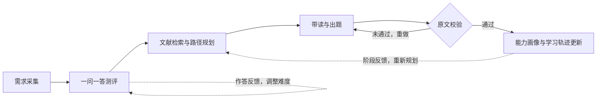

### 面向本科生的自适应文献学习智能体
从“打开论文却读不懂”，到知道该读什么、按什么顺序读，并持续记录自己的理解程度。
论径面向第一次系统阅读专业文献的本科生，以学习者的目标与当前能力为起点，将**诊断、选文、带读、反馈与沉淀**连接成可持续的学习闭环。
## 导航

- [项目定位](#项目定位)
- [学习闭环](#学习闭环)
- [核心功能](#核心功能)
- [系统架构](#系统架构)
- [开发计划](#开发计划)
- [团队协作](#团队协作)
- [文档与项目基线](#文档与项目基线)

## 项目定位

初学者读论文的困难，往往从阅读之前就开始了：不知道自己的基础是否足够，也不知道该从哪篇读起。进入阅读后，术语与前置知识又会打断理解；换一次会话或工具，之前的学习状态还可能丢失。

论径以学习者的状态贯穿检索、阅读与反馈，让选文有依据、难度能调整、进度能延续、过程可回顾。

| 使用者 | 典型场景 | 期望获得的帮助 |
| --- | --- | --- |
| 大一、大二等缺乏科研训练的本科生 | 课程、大创或竞赛要求第一次读专业论文 | 先了解基础，再获得术语解释和适合当前水平的带读 |
| 转入新方向的高年级本科生、研究生新生 | 面对陌生方向，不知道从哪篇开始 | 结合学习目的与测评结果，形成由浅入深的文献阅读路径 |
| 需要跨会话、跨工具或跨设备学习的学生 | 希望延续已有进度与理解程度 | 导出、迁移阶段性能力画像，继续学习 |
| 导师、助教 | 希望了解学生的真实基础 | 参考学习画像，开展有针对性的指导 |

## 学习闭环

1. **明确目标。** 通过需求采集表记录学习目的、论文要求与语言要求。
2. **了解基础。** Planner 采用一问一答的动态交互，根据每次回答调整后续问题难度，初步识别薄弱知识点。
3. **决定读什么。** 将需求与测评结果用于文献检索，规划渐进的阅读路径。
4. **带着理解往前读。** Tutor 提供带读、术语弹窗与题目；Critic 对照原文校验讲解和题目，未通过时重新生成。
5. **让学习留下记录。** Profiler 更新能力画像与学习轨迹；阶段反馈用于重新规划路径，画像支持导出迁移。

## 核心功能

以下均为方案中的功能目标，不代表当前已实现。

| 模块 | 设计要求 | 对应问题 |
| --- | --- | --- |
| 需求采集 | 显式收集学习目的、论文要求、语言要求，为后续检索与规划提供约束 | AI 难以快速理解用户需求 |
| 动态测评 | 一问一答，利用作答反馈实时调整难度，识别薄弱知识点 | 读者水平未知 |
| 文献检索与路径规划 | 结合需求和能力，由浅入深组织文献阅读顺序 | 找文与学习脱节 |
| 带读与出题 | 围绕真实文献讲解，提供术语就地解释和题目 | 初学者难以理解论文 |
| 原文校验 | Critic 检查讲解与题目是否有原文依据，校验未通过时重做 | 生成内容的可信度与可追溯性 |
| 能力画像 | 记录阶段性理解程度，支持导出和迁移 | 跨会话、跨工具时状态不连续 |
| 学习轨迹图谱 | 呈现学习进展，支持分支探索、虚线引导方向与回溯 | 学习过程不可见、容易迷航 |
| 规划与调用链面板 | 展示规划步骤、工具调用、校验结果与重新规划原因 | 用户难以了解系统正在做什么 |

## 系统架构

下图直接取自最终版设计方案，包含主流程、反馈回路及底层支撑。

### 智能体分工

| 角色 | 主要职责 |
| --- | --- |
| Planner | 动态测评、文献检索与渐进阅读路径规划；依据反馈调整问题或重新规划路径 |
| Tutor | 文献带读、术语解释与出题 |
| Critic | 对照论文原文校验讲解与题目，触发未通过内容的重做 |
| Profiler | 更新能力画像与学习轨迹，支持画像导出迁移 |

### 分层支撑

| 层次 | 组成与要求 |
| --- | --- |
| 记忆层 | 短期保存当前论文与会话上下文；中期保存学习轨迹图谱；长期保存可导出迁移的能力画像 |
| 工具层 | 文献检索 API，包含备用源与本地缓存；PDF 解析；术语库与多媒体；图谱生成 |
| 模型层 | 统一 LLM 接口；用户可为不同角色配置并接入不同模型；简单任务使用低成本模型，复杂规划使用较强模型 |
### 演示检查点

- [ ] 需求采集结果能够进入测评与检索规划流程。
- [ ] 测评按一问一答推进，后续问题能依据作答反馈调整难度。
- [ ] 文献与阅读路径能够体现用户需求和当前能力。
- [ ] 带读包含术语解释与题目，讲解和题目经过原文校验。
- [ ] 校验未通过时能够重做，而后继续流程。
- [ ] 学习结果能够更新画像与轨迹，并触发阶段性路径重规划。
- [ ] 画像能够导出迁移，轨迹支持回顾与分支探索。
- [ ] 面板能够展示规划步骤、工具调用、校验结果与重规划原因。
