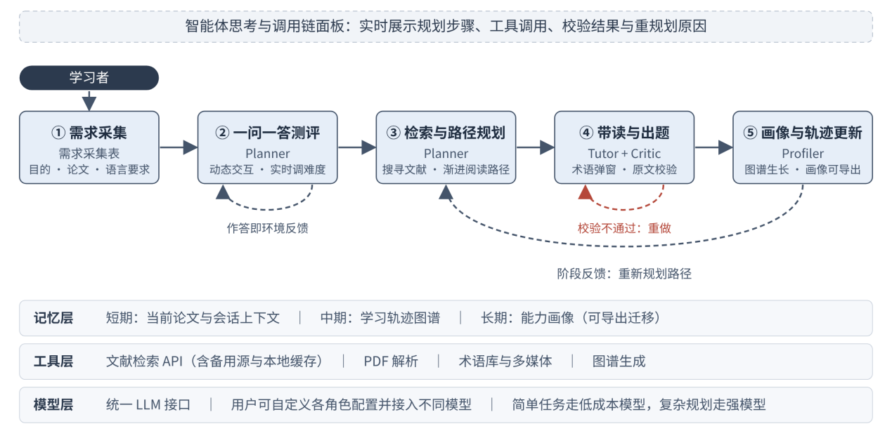

# 论径：面向本科生的自适应文献学习智能体

> **赛事**：第六届厦门大学人工智能挑战赛 · 设计方案 / 项目说明
> **队名**：666谁cai谁请吃饭
> **队长**：董奕萱（22920262203430）
> **队员**：赵艺洁、范子叶
> **日期**：2026 年 11 月 1 日

## 当前可运行版本

当前前端位于 [lun-path](lun-path/README.md)。进入该文件夹执行 `npm start`，打开 [本地项目](http://127.0.0.1:5180/)。无需安装 npm 依赖。

当前已重做藤蔓首页和全景页，支持五个主题分类、向右探索、远近雾气、蝴蝶与中英文切换。按用户要求，早期自制手账、测试、阅读、画像内容及模拟学习代码已删除，相关入口暂留白，后续从原版重做。四套原版参考源码全部保留。下文为产品目标方案，不代表已实现功能。

展示层级为“一个学习方向 → 几个适中的藤蔓分支 → 每个分支一个书架 → 一篇论文一本书 → 四个学习章节”。中文和英文模式只切换操作与辅助内容；论文标题、摘要、正文及原文引文保持原语言。中文模式的大分支保留英文副标题，增强手势后续再做。

---

## 目录

1. [项目概述](#一项目概述)
   - [个性化入口与动态测评](#14-个性化入口与动态测评)
2. [技术实现（拟定）](#二技术实现拟定)
   - [Planner 每轮决策与输出](#25-planner-每轮决策与输出)
3. [开发计划](#三开发计划)
   - [下一阶段实施顺序与验收](#33-下一阶段实施顺序与验收)
4. [备注](#四备注)

---

## 一、项目概述

### 1.1 项目背景

#### 领域现状

科研文献是本科生进入专业领域的重要入口，大语言模型的发展正在改变文献的阅读方式。据公开资料，目前主流的 AI 文献与学习工具可分为三类（表 1）。

**表 1　现有主流方案及其对初学者的不足**

| 类型 | 代表 | 擅长 | 面向初学者的不足 |
| --- | --- | --- | --- |
| 文献检索与综述 | SciSpace、Elicit | 海量论文检索、综述生成、数据提取、单篇问答 | 服务成熟研究者的"提效"；未见读者水平诊断与个性化学习路径 |
| 资料驱动的学习 | NotebookLM | 基于用户上传的资料生成测验、闪卡、思维导图 | 需用户自备资料；导图呈现内容结构，而非学习者自身的学习轨迹 |
| 通用学习辅导 | ChatGPT Study Mode、Gemini Guided Learning | 引导式提问、分步讲解、互动小测 | 不负责"读什么"，不围绕真实文献规划路径 |

#### 存在的问题

初学者在"第一次读论文"时，面临以下四个尚未被解决的问题：

1. **水平未知**：工具不诊断读者基础，给出千人一面的解读，初学者容易卡在术语和前置知识上。
2. **找文与学习脱节**：检索类工具不关心"读不读得懂"，辅导类工具不负责"该读什么"。
3. **状态不连续**：学习进度停留在单次对话里，换设备或换工具后全部丢失。
4. **过程不可见**：在文献间跳转时缺少全局视角，容易迷航，也无法回顾"学到了哪、哪里没懂"。

#### 现有最优方案的局限

综合来看，现有最优方案分别擅长"找和读文献"或"讲解知识"，但尚缺少一个以学习者自身状态为中心，把「诊断—选文—带读—反馈—沉淀」串成闭环的系统。这正是本项目要解决的问题。

### 1.2 项目定位

本项目面向"第一次系统阅读专业文献"的本科生。

#### 应用场景

1. **场景一：第一次读论文。** 课程、大创或竞赛要求阅读论文时，打开 PDF 后术语接连出现，查完一个词又冒出新的前置概念。本作品通过先测评再带读、术语就地讲解、难度实时调整来解决。
2. **场景二：进入陌生方向做调研。** 想了解一个新方向，却不知道从哪篇读起；向通用 AI 求推荐，得到难度参差的长列表，没有先后顺序。本作品根据测评结果检索文献，并排出由浅入深的阅读路径来解决。
3. **场景三：跨工具、跨设备学习。** 换了一个 AI，之前讨论的理解程度全部要重新解释。本作品通过可导出、可迁移的能力画像来解决。

#### 目标人群

- **核心用户**：刚接触专业文献、缺乏科研训练的本科低年级学生（大一、大二）。
- **扩展用户**：转入新研究方向的高年级本科生和研究生新生。
- **协同角色**：导师或助教，可通过学习画像了解学生的真实基础，有针对性地指导。

### 1.3 项目方案

本项目的整体框架如图 1，构成「诊断—选文—带读—反馈—沉淀」的闭环：

**需求采集与初步画像**

1. **自由介绍或直接引导**：用户可自由介绍学习目标、已有基础和当前困难；不想介绍时，直接进入选择题引导；
2. **动态补问**：Agent 调用大模型分析介绍和历次回答，只补问会影响选文、测评或学习安排的关键未知信息，每轮动态决定下一题及选项；
3. **确认初步画像**：向用户展示系统理解的目标、自述基础和约束，允许纠正；信息足够支持下一阶段时结束采集。

**基于真实材料的动态测评（目标约 5 分钟，可跳过或提前结束）**

4. **检索候选论文**：根据初步画像寻找相关方向和适宜起始难度的真实材料，用于试读诊断，暂不固定正式阅读路径；
5. **试读与测评**：围绕可访问的论文片段出题，以选择题加“其他”为主，根据每次回答动态决定追问、补测前置知识、更换片段或结束测评；
6. **修正能力画像**：结合答题证据更新局部知识掌握情况，保留尚未确认的部分。

**主循环**

7. **选文与规划路径**：按修正后的画像确定正式阅读材料和渐进路径，并随学习反馈调整；
8. **带读与出题**：根据已取得的材料提供导读、术语解释和理解测验；取得全文后再支持逐节深入；
9. **Critic 校验**：在题目和讲解呈现前核对原文依据，不通过则重做；
10. **更新学习画像**，形成反馈闭环。

**出口**

11. **画像可导出、可迁移**，换平台后其他 AI 也能据此理解用户的个性化需求。

> 图 1　系统整体框架与闭环

图 1 表示整体模块关系；入口细化为“自由介绍或直接引导 → 动态补问 → 初步画像确认 → 候选论文试读测评”，具体规则见 1.4 节。

问题空间到解空间的映射关系如表 2。

**表 2　问题与解决方式的对应关系**

| 问题 | 该项目的解决方式 |
| --- | --- |
| AI 难以快速理解用户需求 | 从自由介绍或选择题引导中提取目标与约束，并动态补问影响后续决策的关键未知信息，实现检索与规划有的放矢 |
| 水平未知 | 针对读者知识水平未知的情况，通过连续提问，根据读者的回答调整后续问题的难度，并初步识别其薄弱知识点 |
| 不知道如何把握找文与学习 | 对于"读什么、先读哪篇"的问题，通过结合需求与测评结果检索文献并规划渐进路径，实现循序渐进 |
| 内容可信度 | 对于模型幻觉的问题，通过 Critic 校验题目与讲解是否出自原文，实现内容可追溯 |
| 状态不连续 | 对于跨会话、跨工具遗忘的问题，通过可导出迁移的阶段性能力画像，实现学习进度的持久化 |
| 过程不可见、易迷航 | 对于迷失方向的问题，通过学习轨迹图谱、分支探索和虚线引导方向，实现全局可视、随时回溯 |

### 1.4 个性化入口与动态测评

#### 入口体验

第一屏邀请用户介绍自己，不要求填写完整表单：

> **先聊聊你的情况吧**
>
> 你想研究什么、准备完成什么任务？也可以说说学过什么、目前卡在哪里。想到什么说什么，不用全部填写。
>
> 入口按钮：**开始分析** / **直接问我几个问题**。

提供“课程报告”“竞赛项目”“探索新方向”等可点击示例，点击后填入可编辑文本；示例内容须经用户确认提交，才能作为用户信息。用户选择直接引导时，从容易回答的目的选择题开始，与自由介绍入口进入同一个动态决策流程。

#### 动态补问与个性化原则

- **每轮重新分析**：每次提交答案后，结合用户介绍、历史回答和当前画像决定下一题；问题、选项、顺序和数量均可变化。
- **围绕具体任务收窄方向**：逐步明确用户希望完成的成果、当前进度和具体卡点，避免只得到“对人工智能感兴趣”等宽泛标签。
- **只问影响决策的信息**：每题都应明确其答案如何影响选文、测评、讲解方式或学习顺序；不会改变处理方式的问题不主动询问。
- **参考清单可动态增删**：目标、相关经历、期限、语言与资源条件等是候选信息，不是必须填满的字段；年级等信息与当前决策无关时可不问。
- **不重复、不擅自补全**：已明确的信息不重复询问；未提到记录为未知，不当作不会。系统推测须与用户明确表达区分。
- **适时结束**：目标、方向和必要约束足以支持检索与试读时结束采集，其余信息在后续学习中补充；不为填满画像持续追问。

例如，用户已说明“想在两周内复现植物病害识别模型，学过 Python”，无需再问学习目的与期限。下一题可了解其实际编程经历；若用户补充“已经跑通模型，但效果不好”，则转向区分训练表现、换数据后的表现、类别混淆等具体困难。相同研究方向的用户应因目标、经历和卡点不同而获得不同的后续问题。

#### 题目与交互形式

- 一次只展示一个主问题，以**选择题加“其他”**为主；根据问题含义明确单选或多选。
- 采集题提供“不确定”或“暂时跳过”；测评题提供独立的“不太确定”选项，并支持跳过。
- “其他”允许自由输入，由模型分析其含义；测评中的开放回答不能因未匹配选项而直接判错。
- 用户可返回修改、纠正画像或调整目标；系统据此重新判断相关问题与阅读安排，保留无冲突的已有证据。
- 关键测评题可选问“有把握 / 有点犹豫 / 主要靠猜”，作为辅助线索，不必每题重复询问。
- 使用“正在了解你的目标”“正在确认相关基础”等阶段提示；偶尔简短解释问题用途，避免显示固定总题数或暴露后台分析细节。

#### 自述与行为证据

学习目的、时间和个人偏好以用户表达为准；知识掌握程度先参考自述，再通过相关论文片段和答题表现补充证据。每条画像信息记录来源，区分**用户自述、答题证据、系统推测**，并保留待确认项。

一两道题只支持局部能力判断，不直接推断整个领域的水平。例如记录“自述学过机器学习；本次能识别训练集与测试集的作用；数据泄漏概念尚未确认”，而非直接给出“机器学习水平中等”。答题证据与自述不一致时，优先追加有针对性的验证或请用户纠正。

试读测评应围绕用户任务和真实材料展开，根据每次作答决定继续追问、验证前置知识、调整材料或结束。约 5 分钟作为体验目标，初版可参考 4～6 个主问题，允许提前结束或少量追问，不以达到题数作为结束条件。

---

## 二、技术实现（拟定）

> 本节为当前拟定的实现选型，可在开发中调整。

### 2.1 开发工具与项目模型接入

- **开发工具**：开发过程中可使用 Codex 辅助编写、修改和检查代码。
- **项目运行时的模型选型待定**：应用需要调用大模型完成动态分析等任务，但尚未确定模型提供方、具体型号，以及各步骤分别使用哪个模型；也未确定是否需要多个模型或备用模型。
- **功能角色与模型选型分别讨论**：Planner、Tutor、Critic、Profiler 表示流程中的职责，不表示已经为它们分配了独立模型。后续再决定哪些职责共用模型、哪些需要单独配置。
- **接入方式拟保持可配置**：统一管理模型调用与配置，便于后续比较效果、响应时间和成本，再确定各步骤的模型安排。

当前先明确功能与交互流程；具体模型及调用分工待后续选型确认。

### 2.2 文献检索

- 采用 **Semantic Scholar / arXiv** 免费学术接口，由 Agent 根据用户情况自动检索文献标题与摘要。
- 初期不自行构建文献库、不解析 PDF 全文，聚焦把「检索 → 带读」流程跑通；后续再按需引入全文解析。
- 初期试读、出题与讲解限定在已取得的摘要或文本片段范围，并展示对应依据；只有摘要时不生成依赖正文细节的测评，不声称已完成全文校验。涉及方法、实验细节或逐节带读时，需先取得相应正文。

### 2.3 交付形态

- 交付为**响应式网页应用**，适配 iPad（Safari）触控浏览，而非原生 App。
- 手势交互（左右滑动切换文献、点击术语弹出讲解、双指缩放图谱）置于后期实现，作为增强项，不影响主体功能。

### 2.4 数据与学习画像

- 学习画像以 **JSON 文件**存储，天然支持导出与跨平台迁移（换平台后其他 AI 可直接读取）。
- 画像字段拟包含：`学习目的`、`自述不足`、`知识点掌握度[]`、`已读文献[]`、`薄弱点与推荐路径`，并随学习过程持续更新。
- 补充记录：具体任务与预期成果、当前进度、时间与语言约束、相关经历、关键未知项，以及各项判断的信息来源、证据和确认状态；能力结论按证据逐步更新。

### 2.5 Planner 每轮决策与输出

每轮按“接收回答 → 提取并更新信息 → 找出影响当前决策的关键未知项 → 选择下一步动作 → 检查重复与必要性”的顺序执行。模型生成的问题应接受程序侧结构与状态检查，避免重复追问、跑偏或无法结束。

每轮拟返回以下结构化内容，供界面展示、状态保存和流程控制使用：

| 内容 | 用途 |
| --- | --- |
| 已知信息及来源 | 区分自述、答题证据与推测，保留可追溯依据 |
| 关键未知项 | 明确当前哪些信息仍会影响下一步决策 |
| 下一步动作 | 采集阶段选择继续提问或结束采集；测评阶段选择追问、补测前置知识、更换片段或结束测评 |
| 本轮问题 | 继续提问时提供题干、选项、单选或多选，以及其他输入与跳过入口 |
| 提问用途 | 内部说明不同回答将如何影响后续处理；界面按需展示简短说明 |
| 阶段结果 | 采集结束时输出可纠正的初步画像；测评结束时输出局部能力判断、证据、待确认项及阅读建议 |

结束采集后的确认页展示系统对目标、自述基础和约束的理解，允许用户直接修改；不将此时的自述包装为已经验证的能力评分。

---

## 三、开发计划

### 3.1 开发周期

预计开发周期为 **4 周**，另预留 **2 天**用于方案与材料修改。每周日设为"合并日"：各成员将分支合并到主线，并共同跑通一遍完整流程。

**表 3　开发时间安排**

| 时间 | 任务（含功能接入） | 里程碑 |
| --- | --- | --- |
| 第 1 周（2026.11.01–11.07） | 搭建项目骨架，统一 LLM 接口与配置，约定数据格式；搭好后端，让界面和后端连通；接入大模型 | 模拟模式下整条流程从头跑到尾 |
| 第 2 周（2026.11.08–11.14） | 开发各种功能；前后端接口联调 | 完成全部功能开发 |
| 第 3 周（2026.11.15–11.21） | 开发功能检查 | 完整闭环可演示 |
| 第 4 周（2026.11.22–11.28） | 用模拟学生和真实同学反复测试，统计效果；修改问题，降低模型调用成本；整理说明文档，录制演示视频，准备答辩 | 提交材料齐全 |
| 预留（2026.11.29–11.30） | 方案与材料修改、最终检查 | 定稿提交 |

### 3.2 人员分配

队长董奕萱负责整体把握与接入，其余两位成员分头辅助开发功能模块，各自在独立分支上开发，最后合并。

**表 4　人员分工**

| 成员 | 职责 | 主要产出 |
| --- | --- | --- |
| 董奕萱（队长） | 项目骨架；智能体编排与 Planner（一问一答测评、路径规划）；功能开发；接口与数据格式维护；GitHub 分支管理，每周合并与联调 | 可运行的主线、统一接口、Planner 完整的交互界面；检索与带读功能、测试数据；测试数据、文档、答辩材料 |
| 赵艺洁、范子叶 | 功能开发 | _（待补充）_ |
| 全员 | 需求访谈与同学实测、技术文档、答辩准备 | _（待补充）_ |

### 3.3 下一阶段实施顺序与验收

本节记录此前讨论确认的实施优先级；当前已经建立前端演示与基础服务，具体运行范围见文档开头与 `lun-path/README.md`。3.1 节保留原计划日期，不代表真实模型、检索与全部扩展功能已经完成。

1. **确认入口规则与数据约定**：先明确 1.4 节的交互规则、画像来源与 2.5 节的每轮输出内容。
2. **实现入口最小闭环**：制作“自我介绍 → 动态提问 → 初步画像确认”三个页面；明确所需调用与数据格式，具体模型选型确认后再接入验证，检查能否通过少量有针对性的问题问清需求。
3. **试跑不同用户情况**：覆盖目标明确的新手、已有项目但遇到困难的用户、方向未定的用户，以及跳过问题或中途修改目标的情况。
4. **接入论文检索与试读测评**：入口验证通过后，依据初步画像检索真实候选论文，选择可访问的片段开展动态测评，再修正画像并确定正式阅读路径。
5. **扩展主循环**：接续带读、Critic 校验、画像更新与路径调整，逐步实现整体闭环。

入口阶段重点检查：是否重复询问已知信息；用户的不同回答是否带来有意义的后续变化；“其他”、跳过和修改是否被正确处理；能否在信息足够时结束；初步画像是否明确区分自述、证据与推测。

接入试读后继续检查：题目与讲解是否有材料依据；答题证据能否实际改变后续问题、材料或阅读安排；是否避免凭少量题目给出过度宽泛的能力结论。

---

## 四、备注

- 文档与邮件主题命名：**队伍名称 + 队长姓名 + 队长学号**（即 `666谁cai谁请吃饭-董奕萱-22920262203430`）。
- 设计方案按批注提示完成；对于仅赛道二的部分，参加其余赛道的组须将该部分标题删去并重新编号。
